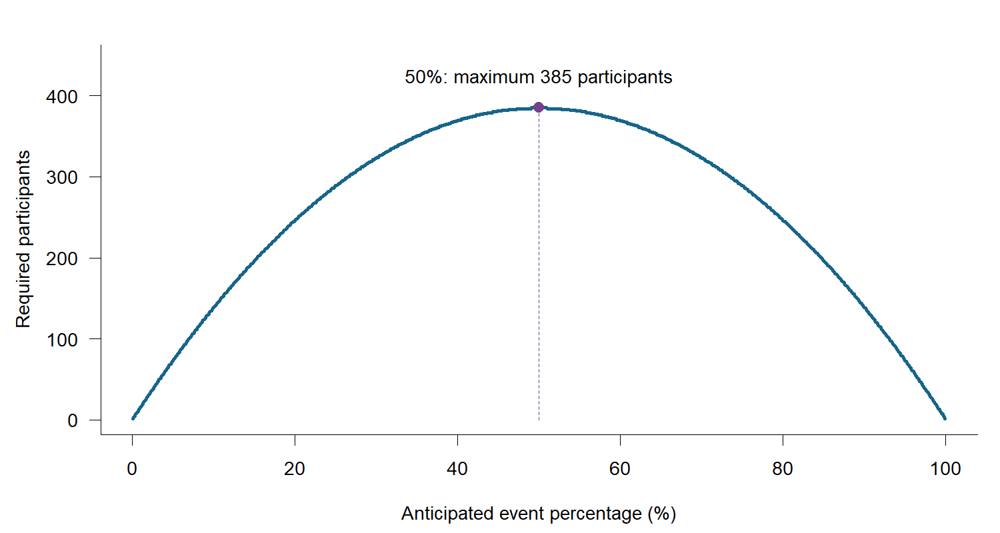

# Common misconceptions and questions {#common-mistakes .unnumbered .reference-heading}

These optional explanations support both routes. Each question links to a difficulty that may arise while reading or planning a study.

Does "20% better" mean 20 percentage points?

The meaning depends on the starting percentage and whether the change is relative or absolute. From a baseline of 80%, a 20% relative increase gives 96%; an absolute increase of 20 percentage points gives 100%. The two-proportion calculator needs the event percentage in each group. R code represents these percentages as probabilities between zero and one, such as 0.80 for 80%. The [discharge example](#discharge) lets you compare these interpretations.

Can I put a clinically important difference directly into the alternative hypothesis?

For the ordinary two-sided superiority test, the alternative is any nonzero difference. Power is evaluated at a particular planned effect. You should interpret the effect estimate and confidence interval in relation to both zero and the clinical threshold.

Does planning for 90% power cover every clinically worthwhile difference?

No. Power is evaluated at the specified target difference. If that target exceeds the smallest clinically important difference, power will generally be lower at some worthwhile benefits. Your justification should explain why the target is important and realistic, including how the study would perform at the clinical threshold. The expected difference, target difference and clinical threshold may coincide, but each has a different role.

Does a non-significant result establish that treatments are the same?

No. An interval might include both negligible and important effects. Your interpretation should consider the whole interval and the design's limitations. Equivalence and non-inferiority ask different questions and require their own margins, hypotheses and planning methods.

Do error probabilities tell me whether a hypothesis is true?

No. The [Type I error probability](#alpha) is the probability of falsely rejecting the null: a false positive when no population difference exists. The [Type II error probability](#beta) is the probability of missing a specified true difference: a false negative. These probabilities describe how the test performs when you assume what is true in the population. The [sampling-distribution example](#alpha-beta) illustrates the distinction.

Does 90% power guarantee a useful result?

No. With [90% power](#statistical-power), about 90% of hypothetical independent studies under the specified effect, design and analysis would reject the null hypothesis. An individual study can be inconclusive, and a significant study can have an interval too wide for a clinical decision. Power, anticipated precision and the observed confidence interval provide complementary information.

Can I use my small pilot's effect estimate without qualification?

Your planning assumptions should reflect its uncertainty and the wider evidence. Small pilots can give unstable treatment estimates; selecting only promising pilots can introduce further bias. Pilot planning should follow feasibility objectives and useful precision for those objectives. See the [practical pilot case](#pilot-feasibility) and [Albers and Lakens (2018)](https://doi.org/10.1016/j.jesp.2017.09.004).

Is 50% a safe default when the event probability is unknown?

Its conservative role here is limited to absolute precision for one proportion under the displayed normal approximation: it maximizes p(1-p). It is not a general fallback for unknown treatment/control probabilities, prediction-model planning, relative precision or rare-event questions. The [single-proportion app](https://katatam.github.io/sample-size-calculation/study/?activity=prevalence) shows how the requirement changes across anticipated percentages.

For a two-group comparison, each event probability should draw on evidence relevant to the population, outcome and follow-up. Comparable studies, routine records or pilot data may help, with particular attention to uncertainty in small pilots. When evidence is limited, your report should describe a plausible range and use [sensitivity analysis](#stress-test-the-study-plan) to show its consequences. The [planning discussion](#what-do-we-expect-what-will-we-plan-for-and-what-matters-clinically) explains how this evidence relates to the target difference.

My study is retrospective: should I calculate observed power instead of sample size?

If the records already exist, your report should explain why that sample is available and present the estimate, confidence interval and limitations. Using the same data's observed effect in a power calculation adds no evidence about that result. At independently justified effects, sensitivity analysis can describe the fixed design's performance. For example, 200 existing records may be useful for estimating a prevalence even when they do not support a precise adjusted treatment effect. "Retrospective" describes when the data were obtained. The research question, outcome and data structure determine the analysis. See [Althouse (2021)](https://pubmed.ncbi.nlm.nih.gov/32814615/) and [Lakens (2022)](https://doi.org/10.1525/collabra.33267).

Why do the hand formula, R and another calculator give different numbers?

Differences can arise from the outcome, allocation, whether the test is one-sided or two-sided, effect scale, Type I error probability, target power, test assumptions, continuity correction or rounding. These settings should match before you compare calculator results. The simple mean calculator uses a normal approximation; the [lab](https://katatam.github.io/sample-size-calculation/study/?activity=own_study) plans for a pooled t test. Binary analytical power remains an approximation and can differ from finite-sample simulation.

Can I count two visits, two eyes or patients in one allocated ward as independent observations?

Usually not. The appropriate calculation depends on what receives the intervention and how measurements are related. A paired design uses within-pair information; cluster allocation requires accounting for within-cluster correlation. The [study-design guide](#study-designs) can help you choose a suitable approach; entering every record as an independent patient would overstate the available information.

Should I add 10% for expected 10% dropout?

With 10% expected loss, you should divide the required analyzable count by 1 - 0.10, then round upward within each arm. This is about 11.1% extra before rounding. The actual number retained can differ from expectation, and missing outcomes can bias results even after recruitment inflation.

Is more simulation the same as a larger study?

Increasing B, the number of simulated studies, estimates power, interval coverage and other performance measures more precisely. Increasing n, the patients per study, changes the amount of patient information in each study and therefore changes its power and precision. Your report should distinguish these quantities and include both.

Will a larger sample solve bias?

A larger sample reduces sampling variability under the model. Selection bias, confounding, unreliable measurements and missing-data bias require attention to the design and analysis. A defensible design is necessary before a sample size calculation can be useful.

Is a reporting checklist a sample-size method?

No. CONSORT, STROBE, STARD, ARRIVE and TRIPOD help document different studies. They prompt you to report how sample size was chosen. The [study-design guide](#study-designs) separates reporting resources from planning methods.

