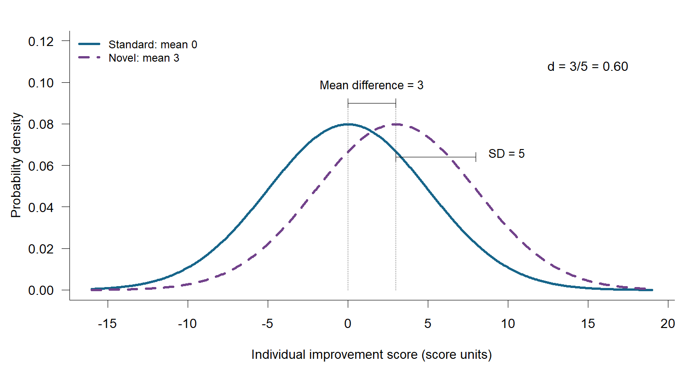

# Glossary {#glossary .unnumbered .reference-heading}

Definitions support both routes. Advanced terms are identified individually; you can return here whenever a term needs clarification.

This glossary provides reminders of terms used in the tutorial and apps. The main tutorial includes formulas and expandable R code blocks.

## Probability, percentages and rates {.core-heading .unnumbered}

A probability describes how likely an event is under stated assumptions. It lies between zero and one and can be expressed as a percentage: a probability of 0.60 is 60%. An observed proportion describes the fraction of observations with an outcome, such as 6 of 10 patients reporting relief; the observed percentage is 60%. That percentage estimates the population probability but need not equal it.

In this tutorial, Type I and Type II error probabilities and power describe how the planned test behaves under specified population assumptions. Simulation estimates these probabilities using the percentage of repeated studies with each result. A time-based rate has a different denominator, such as new cases per 1,000 person-years or patients recruited per month. The binary-outcome calculators use the probability of an event by a specified follow-up time.

## Population, sample and planning values {.core-heading .unnumbered}

The [chronic pain case](#clinical-question) distinguishes the pilot estimates from the assumptions used for planning.

Population parameter
: A population parameter is a feature of the population you want to learn about, such as its mean, proportion, or treatment difference.

Sample estimate
: A sample estimate is calculated from the observations you obtained. In the pain pilot, 7/10 is a sample proportion, expressed as 70%. The treatment probability of 60% used in the sample size calculation is a planning assumption whose justification should draw on evidence and sensitivity analysis. A proportion such as 7/10 can also be written as 0.70 or expressed as a percentage, 70%.

Expected difference
: The [expected difference](#between-group-differences) is the anticipated between-group population difference based on current evidence, with uncertainty. An observed difference is calculated from a particular sample, such as the pilot.

Target difference
: The [target difference](#between-group-differences) is the between-group difference used in the sample size calculation, at which you calculate [power](#statistical-power).

Clinical threshold
: The [clinical threshold](#between-group-differences) is the smallest between-group benefit judged worthwhile, considering the treatment's burdens, risks, costs, and alternatives. These judgments may coincide in practice, but the worked examples use distinct values to show their different roles. For the pain trial, they are 40, 30, and 20 percentage points, respectively.

The target difference should be justified as realistic and important. Planning for a difference larger than the clinical threshold generally gives lower power at some worthwhile differences. See [the target-difference discussion](#what-do-we-expect-what-will-we-plan-for-and-what-matters-clinically) and [DELTA2 guidance (Cook et al., 2018)](https://doi.org/10.1136/bmj.k3750).

## Between-group differences and individual benefit {#between-group-differences .core-heading .unnumbered}

A between-group difference compares outcomes under two treatments in a specified population. For a binary outcome, it can be expressed as a difference in the percentages experiencing the outcome. For a continuous outcome, it may be a difference in mean scores. The expected difference, target difference, and clinical threshold in this tutorial all concern these between-group comparisons.

If 60% of patients experience pain relief with the novel treatment and 30% with standard treatment, the difference is 30 percentage points: approximately 30 more patients per 100 would experience relief with the novel treatment under these assumptions. This does not mean that each patient experiences 30% more pain relief. Similarly, a 3-point difference between group means does not mean that every patient gains 3 additional points. Individual outcomes also vary: patients receiving the same treatment may report substantial, little or no relief. Baseline severity and other characteristics may help explain this variation. Differences between observed outcomes alone do not establish how the treatment effect varies between individuals; in a parallel-group trial, you cannot observe the same patient's outcome under both treatments.

A threshold for meaningful improvement within an individual patient is therefore not automatically a suitable clinical threshold for a between-group comparison. An individual improvement threshold might define who counts as experiencing pain relief. A separate judgment is then needed about what difference between groups in the percentage experiencing relief would make the treatment worthwhile. Before adopting a published "minimum clinically important difference," you should check which comparison it describes and whether its population, outcome, and follow-up match your study ([Cook et al., 2019](https://doi.org/10.3310/hta23600)).

## Effect scale and direction {.core-heading .unnumbered}

Percentage points
: An absolute difference between two percentages is expressed in percentage points: 60% - 30% = 30 percentage points. A relative increase divides the change by the baseline: (60 - 30)/30 = 1, or 100%. An increase from 80% to 96% is 16 percentage points and a [20% relative increase](#relative-increase): (96 - 80)/80 = 0.20. The relative increase uses the starting percentage as its denominator. The [discharge exercise](#discharge) compares these scales. Your report should make clear which scale you mean. Formulas and R inputs represent these probabilities as proportions between zero and one, such as 0.60 and 0.30.

Mean difference
: A mean difference is in the outcome's own units, such as mmHg or score units. The [lab](https://katatam.github.io/sample-size-calculation/study/?activity=own_study) uses treatment minus control. Positive is beneficial in the prepared improvement/relief cases; an outcome such as pain severity or mortality needs an explicit decision about beneficial direction.

Standardized mean difference (Cohen's d)
: A difference between group means expressed in within-group standard-deviation units. In the two-independent-group example, SD describes the spread of individual outcomes within each population, assumed equal across groups. A pooled within-group sample SD estimates that common SD from observed data. A difference of 3 score units with SD 5 gives d = 3/5 = 0.60. The [two-means calculation](#two-means) uses these quantities. Clinical relevance depends on the outcome and study context.

### Effect size {#effect-size .core-heading .unnumbered}

An effect size describes the magnitude of a difference or association on a stated scale. Examples include a difference in event percentages or group means. A standardized mean difference expresses a difference in standard-deviation units. Clinical importance requires a judgment about the outcome, comparison and study context.

## Variation and uncertainty {.core-heading .unnumbered}

The [two-means example](#two-means) illustrates individual variability; the [one-study and many-studies activity](#activity-1-one-study-then-many) illustrates uncertainty in estimates.

Standard deviation (SD)
: Standard deviation (SD) describes how much individual patients differ, in the outcome's units. For example, an SD of 15 mmHg describes the spread of individual blood pressures. The common SD assumption in the two-means example means the populations in both groups have the same SD.

Standard error (SE)
: Standard error (SE) describes how much an estimate would vary if you repeated the study with new patients. For one mean, SE = SD/sqrt(n). If the population SD is 15 mmHg, 25 independent patients give an SE of 3 mmHg; 100 patients give 1.5 mmHg. Increasing the sample size reduces the standard error of the mean while the population SD remains fixed. If the population SD is unknown, the sample SD is used to estimate the SE.

Confidence interval
: A confidence interval shows uncertainty around an estimate under the analysis assumptions. At the same confidence level, a narrower interval indicates greater precision. For a treatment difference, you should compare its limits with zero and the clinical threshold. A 95% interval excludes zero when its corresponding two-sided test rejects at the 5% level; intervals and tests using different methods may disagree. The [clinical interval examples](#interpret-a-confidence-interval-clinically) explain these comparisons. The 95% refers to the method: across repeated studies, about 95% of intervals calculated this way would contain the true population value, if the assumptions hold.

Full interval width
: Full width is the upper confidence limit minus the lower. For a symmetric interval its half-width, or margin of error, is half the full width.

Margin of error
: A margin of five percentage points means a full width of ten percentage points. For asymmetric intervals, the two distances from the estimate to the limits need not be equal.

## Estimation, precision, sampling variability and bias {.core-heading .unnumbered}

### Estimation {#estimation .core-heading .unnumbered}

Estimation uses sample data to learn about a population quantity, such as a mean, a prevalence, or a between-group difference. A point estimate gives a single value; an interval estimate expresses uncertainty around it. Precision describes how much an estimate varies across repeated samples. For example, estimating prevalence is the task; seeking a 95% confidence interval with a margin of error of 5 percentage points sets a precision target. A study planned for hypothesis testing can also provide estimates and confidence intervals.

### Precision {#precision .core-heading .unnumbered}

Precision describes how little an estimate varies across repeated samples; estimation is the process that produces the estimate. You can assess it using the standard error or, at a specified confidence level, the confidence-interval width. A smaller standard error or narrower interval indicates greater precision. A larger independent sample generally improves precision. Bias can still shift the estimate systematically away from the population value. Precision is also distinct from power, which concerns how often a specified test rejects the null under an assumed effect.

### Sampling variability {#sampling-variability .core-heading .unnumbered}

Sampling variability is the variation between estimates from repeated samples drawn under the same population assumptions. In the chronic pain example, the population relief probabilities stay fixed while the observed percentages and their difference vary between trials. This differs from variability between individual patients, measured by quantities such as the standard deviation.

### Bias {#bias .core-heading .unnumbered}

Bias is a systematic deviation of an estimation procedure from the population quantity it aims to estimate. For example, knowledge of allocation might influence which patients are enrolled (selection bias); patients with poor relief might disproportionately miss follow-up (attrition bias); or additional care might differ between groups in ways that distort the intended comparison (performance bias). A large sample can produce a precise but biased estimate. The [missing-outcome discussion](#account-for-expected-losses) explains why prevention, design and analysis matter.

### Estimand (advanced) {#estimand .advanced-heading .unnumbered}

An estimand is the precisely defined population quantity the study aims to estimate. Its definition identifies the treatments, population, outcome, summary measure, and how events such as treatment discontinuation are handled. This makes the intended question clear before choosing an analysis or sample size method. See [ICH E9(R1)](https://database.ich.org/sites/default/files/E9-R1_Step4_Guideline_2019_1203.pdf).

### Sensitivity analysis {#sensitivity-analysis .core-heading .unnumbered}

A sensitivity analysis examines how results or conclusions change under plausible alternative assumptions. In sample size planning, you can either recalculate the required sample for each assumption or keep a chosen sample fixed and evaluate its performance. For example, you might vary the treatment difference, variability, or expected loss to follow-up. For a completed study, sensitivity analyses can examine assumptions about missing outcomes. The [Sensitivity to planning assumptions](#stress-test-the-study-plan) section explains the planning questions, and the [missing-outcome activity](https://katatam.github.io/sample-size-calculation/study/?activity=pain_simulation) illustrates how different missingness mechanisms affect an analysis. These comparisons assess robustness to assumptions.

## Hypotheses, Type I error probability, Type II error probability and power {.core-heading .unnumbered}

The [power chapter](#power) connects these terms to repeated hypothetical studies.

Null hypothesis
: The null hypothesis in these treatment comparisons says that the population outcomes are equal: the between-group difference is zero. Rejecting it means that the chosen test provides sufficient statistical evidence of a difference. When the test does not reject the null hypothesis, the evidence is insufficient to establish a difference. The confidence interval shows which treatment differences remain compatible with the data.

Alternative hypothesis
: The two-sided alternative hypothesis allows a difference in either direction. The target difference specifies the population effect at which power is calculated. Statistical significance is assessed against the null hypothesis.

### True and false positives and negatives {#testing-outcomes .core-heading .unnumbered}

 A positive result means a statistically significant difference; a negative result means no statistically significant difference.

- False positive (Type I error): the test finds a difference when the population outcomes are equal.
- False negative (Type II error): the test misses a difference that exists in the population.
- True positive: the test detects a difference that exists in the population. Its probability at the specified difference is power.
- True negative: the test does not find a difference when the population outcomes are equal. Its probability is 1 minus the Type I error probability. In a real study, a non-significant result can be either a true negative or a false negative.

### Type I error probability {#alpha .core-heading .unnumbered}

Type I error probability ($\alpha$) is the probability of falsely rejecting the null hypothesis: the [false-positive probability](#false-positive). Here, that means finding a statistically significant treatment difference when the population outcomes are actually equal. A 5% probability means about 5 false positives per 100 repeated studies when there is no true difference, under the test's assumptions. It does not mean that 5% of all significant findings are false positives.

### Type II error probability {#beta .core-heading .unnumbered}

Type II error probability ($\beta$) is the probability of failing to reject a false null hypothesis: the [false-negative probability](#false-negative). Here, that means missing a specified true treatment difference. For example, a 10% Type II error probability at a true 30-percentage-point difference means about 10 missed differences per 100 repetitions of that trial. This probability depends on the true difference, sample size and analysis.

### Statistical power {#statistical-power .core-heading .unnumbered}

Power is the probability of detecting a specified true treatment difference with the planned test: the [true-positive probability](#true-positive). It equals $1-\beta$, or 1 minus the Type II error probability. With 90% power, about 90 of 100 repetitions of the planned trial would detect that difference and 10 would miss it. Each repetition involves new patients. A non-significant result can remain compatible with both no effect and a worthwhile benefit.

### P-value {#p-value .core-heading .unnumbered}

A p-value is the probability, assuming the null hypothesis and statistical model are correct, of a test result at least as extreme as the observed result. In the two-sided pain comparison, it asks how likely a result at least as far from equal relief probabilities would be, in either direction, if the population probabilities were equal. A small p-value provides evidence against equality.

## Normal distribution and z-values {.core-heading .unnumbered}

The [multiplier explanation](#how-error-rates-and-power-affect-sample-size) shows how these values enter a sample size calculation.

Z-value
: The standard normal distribution is a bell-shaped curve with a mean of zero and a standard deviation of one. A z-value gives a position on that curve in standard-deviation units. For example, 1.96 is 1.96 standard deviations above its center.

Quantile
: A quantile is a cutoff below which a stated proportion of a distribution lies. For the standard normal distribution, $z_{0.975}=1.96$ means that 97.5% lies below 1.96. The sample size multiplier uses these cutoffs to translate the Type I error probability and target power into numbers for the formula. You can use the tutorial's multiplier table without calculating the cutoffs yourself.

## Tests and designs {.core-heading .unnumbered}

One-sided and two-sided tests
: A two-sided test can reject for sufficiently strong differences in either direction. A one-sided test has a directional rejection rule. For treatment minus control, the two-sided alternative includes any nonzero population difference. A one-sided alternative may specify a positive population difference; its null then includes zero and negative differences. Sidedness needs justification before results are examined. The [sampling-distribution illustration](#alpha-beta) assumes a known population SD and illustrates a one-sided test, while the [core lab](https://katatam.github.io/sample-size-calculation/study/?activity=own_study) uses two-sided comparisons.

A normal approximation uses the bell-shaped normal distribution to simplify a calculation. A t-test calculation also accounts for estimating variability from the study's patients. The simple calculators use labeled normal sample-size approximations; the [lab](https://katatam.github.io/sample-size-calculation/study/?activity=own_study)'s mean planning uses pooled two-sample t-test power. See the [statistical methods](../documentation/statistical-methods.md) for exact implementation details.

Independent, paired and clustered observations
: In the core examples, different patients belong to the two groups, with each patient contributing one outcome. The analysis assumes that one patient's outcome does not provide information about another patient's outcome beyond what the model accounts for. Different participants are not sufficient to establish independence: outcomes may still be related within clinics or families. Paired/within-subject data include linked measurements, such as both eyes or before/after observations from the same person. Clustered data include participants linked within allocated practices or wards. Correlation affects information and therefore planning; counting every measurement as independent can overstate the information available.

## Advanced analysis terms {.advanced-heading .unnumbered}

Covariate adjustment
: A prespecified analysis can use prognostic baseline characteristics, such as baseline pain, to improve precision in a randomized treatment comparison. For a continuous outcome this may use analysis of covariance (ANCOVA). Its precision gain and sample size planning depend on the model and predictive value of those characteristics. Investigating whether treatment effects vary with a characteristic requires a treatment-by-characteristic comparison and its own justification. See the [design and analysis discussion](#increase-power) and [FDA guidance](https://www.fda.gov/regulatory-information/search-fda-guidance-documents/adjusting-covariates-randomized-clinical-trials-drugs-and-biological-products) [@fda2023covariates].

## Advanced units and dependence {.advanced-heading .unnumbered}

### Unit of randomization {#unit-of-randomization .advanced-heading .unnumbered}

The entity assigned to a treatment, such as a participant, hospital, or body site. The allocation structure determines where independent treatment assignments occur.

### Unit of measurement {#unit-of-measurement .advanced-heading .unnumbered}

The entity or occasion for which an outcome is recorded, such as a participant, lesion, or visit. Several measurements can come from the same participant.

### Unit of analysis {#unit-of-analysis .advanced-heading .unnumbered}

The entity represented in the analysis. Individual measurements can be analyzed with a model that accounts for dependence within participants or clusters.

### Paired observations {#paired-observations .advanced-heading .unnumbered}

Two linked observations, such as outcomes from two treated sites in one participant. A paired analysis uses the within-pair comparison and accounts for the relationship between the observations.

### Intracluster correlation coefficient (ICC) {#intracluster-correlation .advanced-heading .unnumbered}

A measure of similarity between outcomes within the same cluster. In a simple random-intercept model, it is the proportion of total outcome variance attributable to differences between clusters.

### Design effect {#design-effect .advanced-heading .unnumbered}

The ratio of the variance of an estimate under a specified design to that under a comparable independent-observation design. For a simple cluster design with equal cluster size m and ICC rho, it is approximately 1 + (m - 1)rho; this can guide an initial sample size inflation.

The [advanced explanation of units and dependence](#units-of-analysis) compares cluster-randomized and within-person designs [@campbell2012consort; @pandis2017withinperson].

## Counts and losses {.core-heading .unnumbered}

Analyzable and recruitment counts
: Analyzable sample size (n) means the number of participants included in the stated analysis; app labels use "participants for analysis". In the [two-group lab](https://katatam.github.io/sample-size-calculation/study/?activity=own_study) it is per group; the total is 2n. Recruitment n is inflated for anticipated losses, rounding within each arm. With expected dropout of 10%, divide by the retention proportion 0.90, rather than multiplying by 1.10. Missing-data bias requires attention to prevention and analysis.

Retention
: The percentage or proportion of enrolled participants who contribute the required outcome at the specified time. If 20 of 200 enrolled participants lack that outcome, 180/200 = 90% are retained and 10% are lost. The [recruitment calculation](#account-for-expected-losses) uses anticipated retention, with uncertainty and potentially different percentages across arms.

## Advanced simulation terms {.advanced-heading .unnumbered}

Planning and generating scenarios
: The planning scenario contains the assumptions used to choose the sample size. A generating scenario contains the population values assumed to be true when simulating studies. Keeping the planned sample size fixed while changing those population values shows how the same study could perform if reality differed from the plan. Recalculating the sample size each time instead asks how the plan would need to change.

Simulation repetitions (B)
: B counts independent simulated studies; n gives the number of patients in each study or group. The [simulation walkthrough](#simulation) shows how studies are generated, analyzed and summarized.

### Monte Carlo error {#monte-carlo-error .advanced-heading .unnumbered}

Monte Carlo error is the random difference between a result estimated from a finite simulation and the value you would obtain from indefinitely many repetitions under the same assumptions. For example, one batch of 1,000 simulated trials might estimate power at 80%, while another gives 79% or 81%, even though the population assumptions, sample size and analysis stay the same. This variation between batches is Monte Carlo uncertainty.

The Monte Carlo standard error (MCSE) describes how much the simulation estimate varies between independent batches. For an observed proportion of statistically significant simulated results $\hat p$ from $B$ independent simulated trials, $\mathrm{MCSE}=\sqrt{\hat p(1-\hat p)/B}$. At estimated power of 80% with 1,000 trials, the MCSE is about 1.3 percentage points. A Monte Carlo interval describes uncertainty in an estimated simulation result, such as power.

Increasing the number of simulations reduces Monte Carlo error; quadrupling the repetitions approximately halves the MCSE. Each trial retains its original power under the same design and population assumptions. Analytical-approximation error and the credibility of the population assumptions require separate assessment. You should distinguish simulation uncertainty from sampling uncertainty within a trial and uncertainty about the clinical assumptions. The [simulation-precision section](#precision-of-a-simulation) provides a worked example.

For more detail, return to the [power chapter](#power), [sampling-distribution illustration](#alpha-beta), [precision planning](#plan-for-precision), or [common mistakes](#common-mistakes). Methodological sources include Kirkwood and Sterne (2003), Whitley and Ball (2002), and the R documentation cited in the tutorial.

## Research ethics review {.unnumbered}

### Research ethics committee (REC) {#research-ethics-committee .unnumbered}

An independent committee that reviews research involving human participants, including its scientific justification and protection of participants. Names and legal responsibilities vary by country. The [Declaration of Helsinki](https://www.wma.net/policies-post/wma-declaration-of-helsinki/) describes the international ethical principles; applicable national requirements determine the review process.

### Institutional review board (IRB) {#institutional-review-board .unnumbered}

The usual US term for a committee that reviews research involving human participants. Applicable FDA or HHS rules define its responsibilities and the studies requiring review. See the [FDA guidance](https://www.fda.gov/regulatory-information/search-fda-guidance-documents/institutional-review-boards-frequently-asked-questions) and [HHS overview](https://www.hhs.gov/ohrp/regulations-and-policy/guidance/faq/45-cfr-46/index.html).

The following three terms describe the Netherlands specifically.

### WMO {#wmo .unnumbered}

The Medical Research Involving Human Subjects Act is Dutch legislation governing research within its scope. Such research needs prior ethical review. The applicable framework depends on the study; the [CCMO guidance](https://english.ccmo.nl/investigators) explains the review routes.

### METC {#metc .unnumbered}

An accredited medical research ethics committee, or MREC in English, reviews most WMO research. Review considers scientific value, participant protection, and the balance of risks and potential benefits.

### CCMO {#ccmo .unnumbered}

The Central Committee on Research Involving Human Subjects directly reviews specified categories of research and has national oversight responsibilities. The [official review guidance](https://english.ccmo.nl/investigators/primary-submission-to-the-review-committee) specifies which studies are reviewed by the CCMO and which by an accredited METC.
